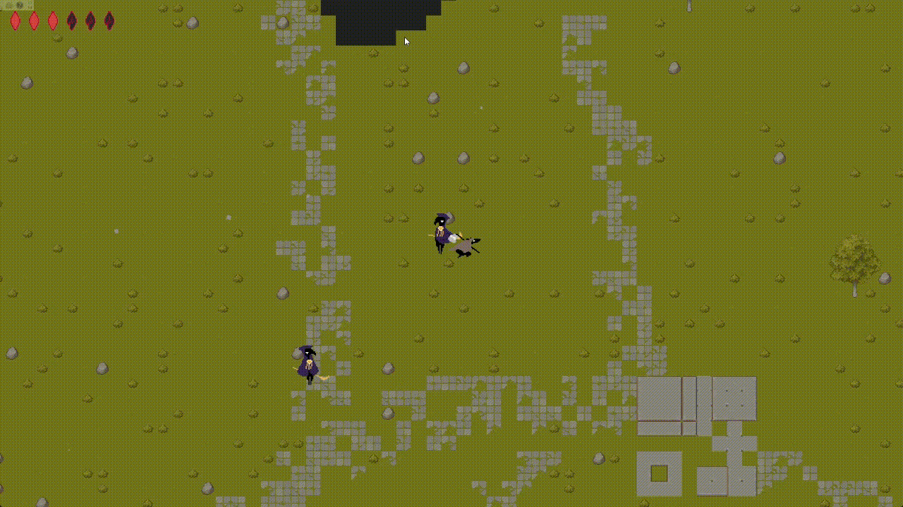
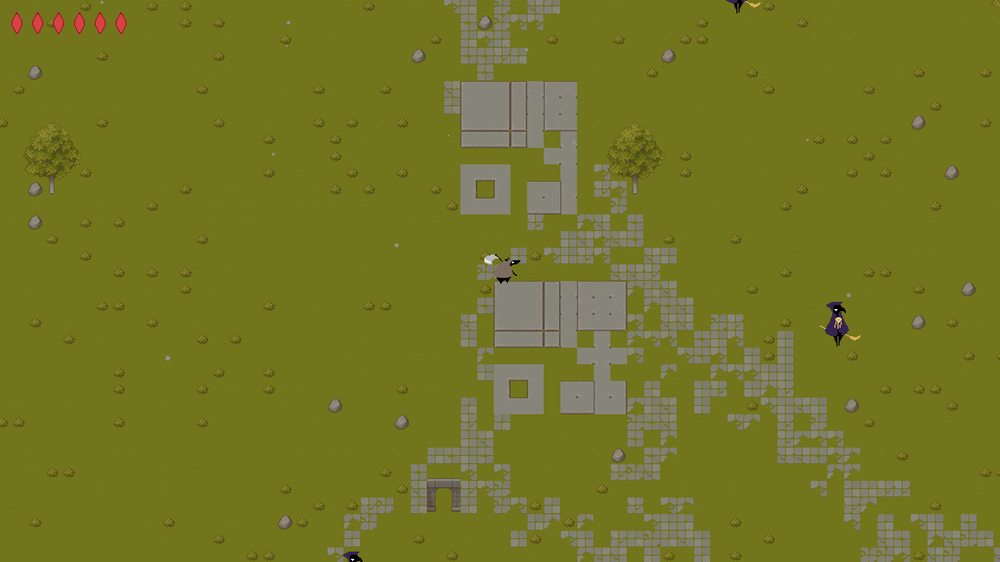
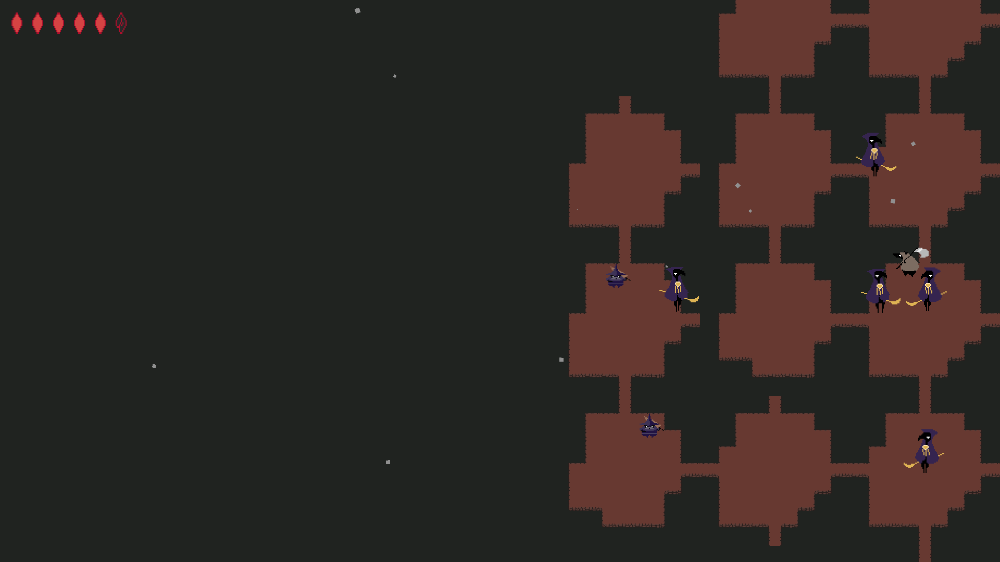
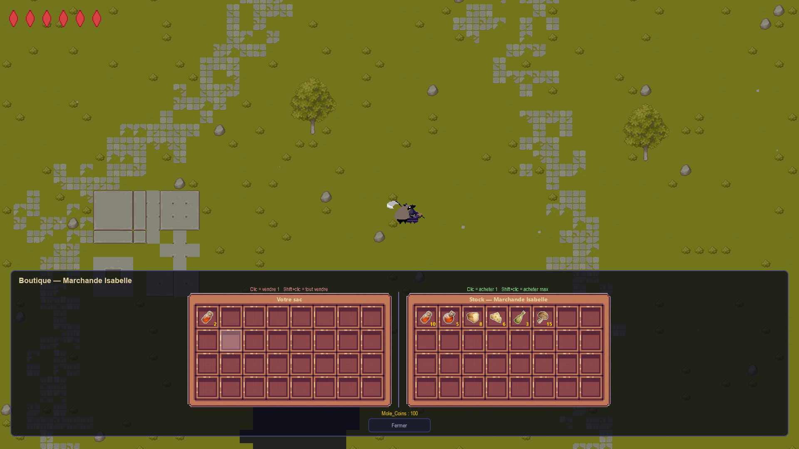
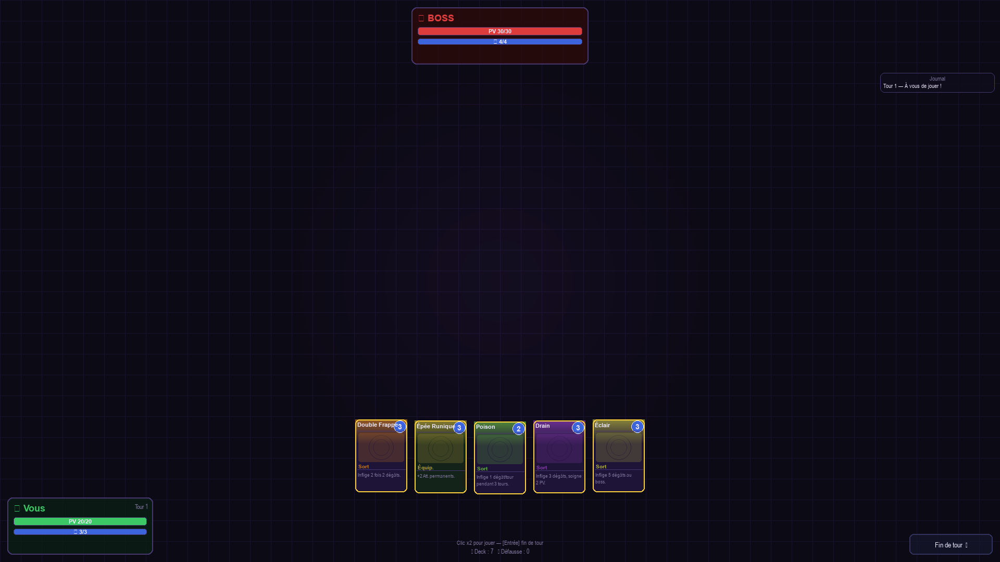

# MoleTale

> A mole, a scythe, and one mission: bring back the sun by eliminating the crows.



## Table of Contents

- [About](#about)
- [Features](#features)
- [Screenshots](#screenshots)
- [Requirements](#requirements)
- [Installation](#installation)
- [Running the Game](#running-the-game)
- [Controls](#controls)
- [Game Modes](#game-modes)
- [Saves](#saves)
- [Project Structure](#project-structure)
- [Architecture](#architecture)
- [Debugging](#debugging)
- [Known Limitations](#known-limitations)
- [Credits](#credits)

## About

MoleTale is a 2D action-adventure game written in Python for EPITA first year project.
This game is a rogue like open procedural world game, with card game for boss fight.

## Features

- **Procedural world**: a Perlin-noise overworld, with chunks loaded on the fly
- **Procedural dungeons**: rooms generated by expanding connected layouts
- **NPCs**: dialogues, quests, a shop, and permanent upgrades
- **Boss fight**: a card-based mini-game against the boss
- **Local co-op**: host or join a game over the local network

## Screenshots

| Overworld | Dungeon |
|---|---|
|  |  |

| NPC interface | Boss card game |
|---|---|
|  |  |

## Requirements

- Python 3.10 or newer
- Supported operating systems : Windows 10/11

Python packages are listed in `requirements.txt`.

## Installation

```bash
git clone https://github.com/Materwan/Projet-J3D.git
cd Projet-J3D

python -m venv .venv
.venv\Scripts\activate

pip install -r requirements.txt
```

## Running the Game

```bash
.venv\Scripts\activate
python main.py
```

## Controls

| Action | Key |
|---|---|
| Move | Z Q S D (configurable in Settings) |
| Attack | Space |
| Interact with NPC | E |
| Inventory | Tab |
| Use consumable | Right-click |
| Transfer a full stack | Shift + click |
| Pause | Escape |

## Game Modes

### Single player

Create a save slot from the main menu and start playing.

### Multiplayer (local network)

1. The host creates a game from the multiplayer menu.
2. The guest joins from the same menu.
3. Both machines must be on the same local network.

The game uses **UDP 9999** for discovery and **TCP 8888** for gameplay. If the connection fails, allow Python through your firewall.

## Saves

Save files are stored in the `save/` folder. Each mode has up to 3 save slots.

## Project Structure

| File | Role |
|---|---|
| `main.py` | Entry point, `Manager` (state machine) |
| `game.py` | Game logic, networking, death and respawn, recap |
| `map.py` | Maps: `Map` (procedural), `Hub`, `Dungeon`, `MapManager` |
| `player.py` | Solo, host, and guest controllers |
| `ennemis.py` | Enemy AI (A*) |
| `pnj.py` | NPCs, dialogues, quests, shop |
| `inventory.py` | Inventory, drag and drop, loot |
| `cardGame.py` | Boss card game |
| `network.py` | TCP and UDP networking (host and guest) |
| `menu.py`, `loading.py` | Menus and loading screens |
| `hud.py`, `camera_system.py` | HUD and camera |
| `particule.py`, `sound.py`, `animations.py` | Particles, sound, animations |

## Architecture

- **Screens**: each `DefaultManager` is a screen manager (`event`, `update`, `display`, `set_screen`) and is registered in `Manager.states`.
- **Chunk generation**: runs in a dedicated thread (`Map._load_chunks`).
- **Networking**: uses double buffering with a `dirty` flag, so the game loop exchanges data at 60 FPS without blocking the network thread.

## Debugging

| Key | Action |
|---|---|
| F1 | Toggle FPS display |
| F2 | Toggle hitboxes and enemy paths |
| F3 | Print sent and received network data to the console |
| F11 | Toggle fullscreen |

## Known Limitations

- Only tested on Windows
- The card game is a prototype and needs balancing

## Credits

- **Clément Bellot**: responsible of the card game
- **Nathan Lemoine**: responsible of the particules, assets, and graphics designer
- **Titouan Marty**: responsible of the menus
- **Erwan Mercier**: team manager and responsible of the map generation and AI
- **Thibaut Sancier**: responsible of the multiplayer, and NPC
- Thanks to [Cainos](https://cainos.itch.io) for the [overworld asset](https://cainos.itch.io/pixel-art-top-down-basic)